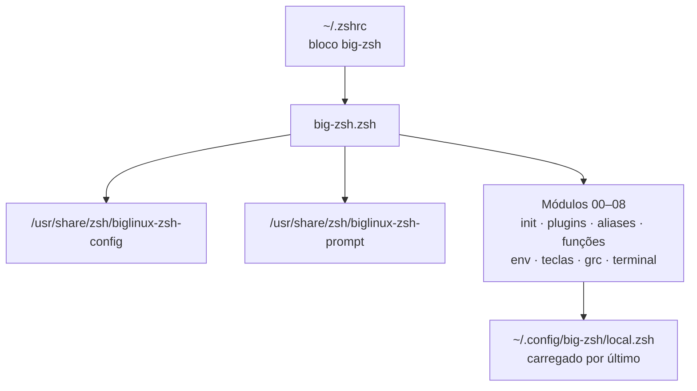

<!-- markdownlint-disable MD033 MD041 -->
<div align="center">

# ⚡ Big Zsh

**Zsh no BigLinux, sem abrir mão do que o sistema já entrega.**

Uma camada pessoal e opcional que acrescenta atalhos e integrações ao Zsh oficial do BigLinux,<br>
preservando o Bash, os comandos tradicionais e a configuração original do sistema.

<br>

[](LICENSE)
[](https://github.com/BrunodosSantosVaz/big-zsh/commits/main)
[](https://github.com/BrunodosSantosVaz/big-zsh/stargazers)
<br>
[](https://www.zsh.org/)
[](#-compatibilidade)
[](install-deps.sh)
[](#-desinstalação)

<br>

<a href="#-instalação"></a>
<a href="#-o-que-é-adicionado"></a>
<a href="COMPATIBILITY.md"></a>

</div>

<!-- Captura de tela: adicione uma imagem real do terminal em docs/terminal.png e descomente.
<p align="center">
  
</p>
-->

<br>

> [!NOTE]
> Projeto comunitário independente, sem vínculo oficial com o BigLinux. O BigLinux cuida muito bem do terminal e já entrega configurações próprias para Bash e Zsh. Este projeto nasceu de uma preferência pessoal pelo Zsh e não pretende corrigir, substituir ou competir com o trabalho do BigLinux.

<details>
<summary><b>Sumário</b></summary>

- [Princípios](#-princípios)
- [Compatibilidade](#-compatibilidade)
- [Instalação](#-instalação)
- [O que é adicionado](#-o-que-é-adicionado)
- [Como funciona](#-como-funciona)
- [Configuração](#-configuração)
- [Desinstalação](#-desinstalação)
- [Segurança e privacidade](#-segurança-e-privacidade)
- [Contribuindo](#-contribuindo)
- [Licença e marcas](#-licença-e-marcas)

</details>

## 🧭 Princípios

<table>
<tr>
<td width="33%" valign="top">

### 🤝 Usa o oficial
Carrega a configuração e o prompt Zsh fornecidos pelo próprio BigLinux, sem copiá-los.

</td>
<td width="33%" valign="top">

### 🛡️ Preserva o tradicional
`ls`, `cat`, `grep`, `find`, `du`, `df` e `ps` mantêm o comportamento de sempre. O Bash e o `.bashrc` ficam intactos.

</td>
<td width="33%" valign="top">

### ↩️ Reversível
Cria backup antes de alterar o `.zshrc` e pode ser removido sem desfazer a configuração original.

</td>
</tr>
</table>

- Ferramentas modernas entram **pelos próprios nomes** e por atalhos opcionais.
- Zsh e Bash são shells diferentes, então não existe equivalência literal para toda construção. O Bash original continua sempre disponível com `bash` ou `bash-native`.

## 🐧 Compatibilidade

Direcionado ao **BigLinux atual**, baseado em Arch/Manjaro, com os arquivos oficiais instalados:

```text
/usr/share/zsh/biglinux-zsh-config
/usr/share/zsh/biglinux-zsh-prompt
```

| Permanece intacto | |
|---|:-:|
| Bash, `~/.bashrc` e `/etc/bash.bashrc` | ✅ |
| Configuração e prompt Zsh oficiais do BigLinux | ✅ |
| Comandos tradicionais e suas opções | ✅ |
| Gerenciador de pacotes e atualizações do sistema | ✅ |
| Scripts com shebang Bash | ✅ continuam usando Bash |

Em outras distribuições, o instalador encerra sem modificar nada (ele valida `ID=biglinux`). Veja [COMPATIBILITY.md](COMPATIBILITY.md).

## 🚀 Instalação

Revise os scripts antes de executá-los. O instalador usa `pacman` para dependências oficiais, pede `sudo` direto no terminal e nunca recebe senha por argumento.

```bash
git clone https://github.com/BrunodosSantosVaz/big-zsh.git ~/big-zsh
cd ~/big-zsh
./install-deps.sh
```

O `install-deps.sh` instala os pacotes que faltam e, no fim, chama o `setup-zshrc.sh`, que acrescenta o bloco ao `.zshrc` com backup. Teste uma nova sessão:

```bash
zsh
```

Se gostar, torne o Zsh o shell padrão (opcional, o Bash continua instalado):

```bash
chsh -s "$(command -v zsh)"
```

<details>
<summary><b>Pacotes instalados se estiverem faltando</b></summary>

`zsh` · `eza` · `bat` · `ripgrep` · `fd` · `dust` · `duf` · `procs` · `hyperfine` · `fzf` · `zoxide` · `git-delta` · `lazygit` · `libqalculate`

Alguns desses pacotes (`hyperfine`, `git-delta` e `lazygit`) só são instalados, sem atalhos próprios.

Todos vêm dos repositórios configurados no `pacman`. Nada é baixado por `curl | sh`.

</details>

## ✨ O que é adicionado

### Ferramentas modernas, com nomes próprios

| Atalho | Ferramenta | Comando tradicional preservado |
|---|---|---|
| `l` · `ll` · `la` · `lt` | [eza](https://github.com/eza-community/eza) | `ls` |
| `rg` | [ripgrep](https://github.com/BurntSushi/ripgrep) | `grep` |
| `fd` | [fd](https://github.com/sharkdp/fd) | `find` |
| `dust` | [dust](https://github.com/bootandy/dust) | `du` |
| `duf` | [duf](https://github.com/muesli/duf) | `df` |
| `procs` | [procs](https://github.com/dalance/procs) | `ps` |
| `bat` | [bat](https://github.com/sharkdp/bat) | `cat` |

### Git

| Atalho | Comando |
|---|---|
| `g` | `git` |
| `gs` | `git status -sb` |
| `ga` | `git add` |
| `gc` | `git commit` |
| `gp` | `git push` |
| `gd` | `git diff` |
| `gl` | `git log --oneline --graph --decorate` |

### Navegação e shell

| Atalho | O que faz |
|---|---|
| `..` · `...` · `....` | Sobe um, dois ou três diretórios |
| `z` | Pula para diretórios frequentes com [zoxide](https://github.com/ajeetdsouza/zoxide), quando disponível |
| `bash-native` | Abre uma sessão Bash de login (`exec bash -l`) |
| `reload-zsh` | Recarrega o Zsh (`exec zsh`) |
| <kbd>Ctrl</kbd>+<kbd>X</kbd> <kbd>Ctrl</kbd>+<kbd>E</kbd> | Edita a linha de comando no `$EDITOR` |

### Funções

| Função | Uso | O que faz |
|---|---|---|
| `mkcd` | `mkcd DIRETÓRIO` | Cria o diretório e entra nele |
| `backup` | `backup ARQUIVO` | Copia com sufixo `.backup-AAAAMMDD-HHMMSS` |
| `extract` | `extract ARQUIVO` | Extrai `tar`, `gz`, `bz2`, `xz`, `zip`, `7z` e `rar` |
| `killport` | `killport PORTA` | Encerra o processo escutando na porta TCP (usa `lsof`) |
| `h` | `h COMANDO` | Mostra a ajuda do comando com destaque do `bat` |
| `=` | `= 2+2` | Calculadora com `qalc` |

### Integrações opcionais

- **[fzf](https://github.com/junegunn/fzf)**: atalhos de teclado e completions.
- **[mise](https://mise.jdx.dev/)**: ativado quando instalado.
- **Completion** sem diferenciar maiúsculas e minúsculas.
- **Histórico** que descarta duplicatas antigas primeiro e ignora comandos iniciados por espaço.
- **`~/.local/bin` e `~/bin`** acrescentados ao `PATH` sem substituir o do BigLinux.
- **grc-rs** colorindo `ping`, `traceroute`, `ip`, `ss` e `diff`, só com `BIG_ZSH_ENABLE_GRC=1`.

## ⚙️ Como funciona



O ponto de entrada carrega a configuração e o prompt oficiais do BigLinux (se ainda não estiverem carregados), depois os módulos numerados em ordem e, por fim, a sua configuração pessoal. Títulos de janela, OSC 7 e Powerlevel10k continuam gerenciados pelo BigLinux.

<details>
<summary><b>Estrutura do repositório</b></summary>

```
big-zsh/
├── big-zsh.zsh          Ponto de entrada (source no .zshrc)
├── 00-init.zsh          Opções de histórico, completion e fzf
├── 01-plugins.zsh       mise e zoxide
├── 02-mise.zsh          Módulo de compatibilidade
├── 03-aliases.zsh       Navegação, Git e eza
├── 04-functions.zsh     mkcd, backup, killport, extract, h e =
├── 05-env.zsh           PATH, EDITOR e VISUAL
├── 06-keybindings.zsh   Edição estilo Emacs
├── 07-grc.zsh           Cores do grc-rs (opcional)
├── 08-terminal.zsh      Integração do terminal
├── install-deps.sh      Instalador principal
├── setup-zshrc.sh       Adiciona o bloco ao .zshrc com backup
├── uninstall.sh         Remove o bloco do .zshrc com backup
└── test-setup.sh        Verificações de sintaxe e carregamento
```

</details>

## 🔧 Configuração

O instalador acrescenta ao `.zshrc` apenas um bloco identificado:

```zsh
# >>> big-zsh >>>
source "/caminho/para/big-zsh/big-zsh.zsh"
# <<< big-zsh <<<
```

Configurações pessoais ficam em `~/.config/big-zsh/local.zsh`, carregado por último e fora do repositório.

```zsh
# ~/.config/big-zsh/local.zsh
export EDITOR=nvim
export BIG_ZSH_ENABLE_GRC=1
```

## 🧹 Desinstalação

```bash
./uninstall.sh
```

Remove somente o bloco gerenciado do `.zshrc`, com backup antes. Dependências e seus dados pessoais não são apagados. Para voltar ao Bash na hora: `exec bash -l`.

## 🔐 Segurança e privacidade

- Nenhuma credencial é necessária. Não passe senhas como argumento e não coloque tokens em arquivos `.zsh`.
- O instalador aceita somente BigLinux, usa pacotes do `pacman`, não muda o shell padrão sozinho e cria backup antes de editar o `.zshrc`.
- Encontrou uma vulnerabilidade? Use o recurso **Report a vulnerability** do GitHub. Veja [SECURITY.md](SECURITY.md).

## 🤝 Contribuindo

Contribuições respeitosas são bem-vindas. O objetivo é somar ao ecossistema BigLinux e oferecer uma opção a quem também prefere Zsh.

1. Preserve os comandos tradicionais por padrão.
2. Não copie arquivos, ícones ou marcas de terceiros para o repositório.
3. Não inclua caminhos pessoais, credenciais ou dados privados.
4. Mantenha a instalação reversível.
5. Rode as verificações:

```bash
./test-setup.sh
```

Pull requests devem explicar o problema, a solução e como a mudança foi testada. Veja [CONTRIBUTING.md](CONTRIBUTING.md).

## 📄 Licença e marcas

Código sob a [Licença MIT](LICENSE). Dependências permanecem sob suas próprias licenças. Consulte [THIRD_PARTY_NOTICES.md](THIRD_PARTY_NOTICES.md).

BigLinux e os nomes de projetos de terceiros pertencem aos respectivos titulares. A menção serve apenas para indicar compatibilidade e atribuição. Este projeto não distribui os arquivos oficiais do BigLinux: ele usa os que já existem no sistema do usuário.

<div align="center">

<br>

<sub>Feito por <a href="https://github.com/BrunodosSantosVaz">Bruno Vaz</a>, com admiração e respeito pelo trabalho da comunidade BigLinux.</sub>

<br><br>

<a href="https://star-history.com/#BrunodosSantosVaz/big-zsh&Date">
  
</a>

<br>

<sub>Curtiu o Big Zsh? Deixe uma ⭐ no repositório.</sub>

</div>
